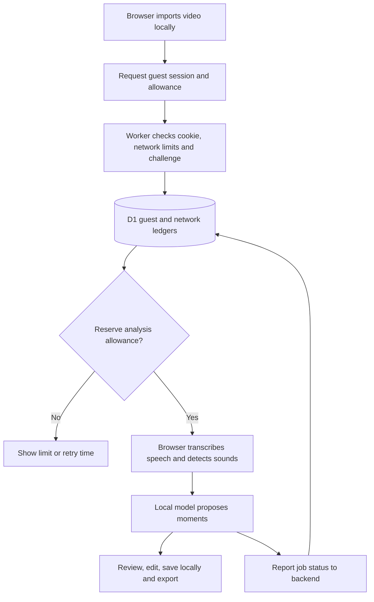

# MVP backend: stack, guest limits and learning path

Updated 21 November 2026. Selected implementation direction, not shipped functionality. This accompanies the [MVP checklist](mvp-plan.md) and [product tiers](product-tiers.md).

## The stack we will use

| Tool/service | Job in Moment Lark | Plain-language explanation |
| --- | --- | --- |
| TypeScript | Backend language as well as frontend language | Use familiar types, functions, promises and fetch; learn server responsibilities without another language. |
| Hono | HTTP routes and middleware | Connect a URL such as `/api/guest/session` to the function that handles it. |
| Cloudflare Workers | Run backend code | Cloudflare executes our request handlers; we do not maintain a server machine. This is a Workers runtime, not a conventional Node.js server. |
| Cloudflare D1 | SQL database | Store guest records, balances, reservations and network counters. Use parameterized SQL through the D1 binding initially; no ORM needed for the first small schema. |
| Cloudflare Turnstile | Bot challenge | Slow automated creation of guest sessions. Verify every submitted challenge token on the backend; it is not proof of a unique person. |
| Zod | Runtime input validation | Check incoming JSON; TypeScript types alone cannot validate an HTTP request. |
| Wrangler | Local development and deployment | Run the Worker and local D1, configure bindings/secrets, then deploy. |
| Workers Static Assets | Host the existing Next.js export | Serve `out/` alongside the API on one origin. |

Sources: [Workers TypeScript](https://developers.cloudflare.com/workers/languages/typescript/), [Hono on Workers](https://hono.dev/docs/getting-started/cloudflare-workers), [D1 API and transactional batches](https://developers.cloudflare.com/d1/worker-api/d1-database/), [Turnstile server validation](https://developers.cloudflare.com/turnstile/get-started/server-side-validation/).

The repository already exports Next.js and deploys Workers Static Assets. Keep that architecture: add a Worker entry point and route `/api/*` to it using `assets.run_worker_first`; serve exported pages as assets. Unknown API paths return JSON 404s. Next.js static export cannot execute request-time API handlers. No OpenNext adapter is required for this plan. See [Worker/asset routing](https://developers.cloudflare.com/workers/static-assets/routing/worker-script/) and [Next.js static export limitations](https://nextjs.org/docs/app/guides/static-exports).

## What stays where



Only session, allowance and minimal job metadata go to our API. Guest video/audio, transcripts, clips and project content stay on the device. Model downloads still require network access initially. New analysis requires online authorization; existing local editing/export need not depend on the API. The browser performs heavy computation; Workers is not the AI/video processing machine.

## Guest and IP policy

Use **guest credits plus a shared network allowance**. This explicitly addresses a user reopening the app in incognito on the same connection.

1. Read the connecting IP at the trusted Cloudflare ingress, not from JSON or a client-supplied forwarding header. Canonicalize IPv4/IPv6 and derive a network key using HMAC with a server secret. Validate the deployed proxy/Worker path; do not assume every forwarded header is trustworthy.
2. Issue a random session token in a host-only Secure, HttpOnly, SameSite cookie. Store a digest of the token, with expiry, attached to a guest record. A cookie identifies a session; an IP is a network grouping.
3. Associate the session/job with that network key. Independently cap new guest issuance per network/time window and aggregate analysis minutes per network/window. Keep each guest's own credit balance too.
4. Before analysis, reserve against both balances in one atomic database operation. A new incognito guest does not reset the existing network bucket. A challenge may permit session creation but never clears a spent allowance.
5. Keep the same guest ledger if a recognized guest changes network; check the new network bucket too. Bind each reservation to the bucket used at authorization so later completion/refunds update the original bucket.
6. Never recover an old guest cookie, reveal their balance/history, or grant access to their jobs solely because an IP matches. Different people on the same Wi-Fi remain separate guests.
7. Return a clear `429` response and retry time for a temporary network cap. Account-based exemptions can be added when accounts exist; do not offer a sign-in button before it works.

**Example, not final policy:** suppose a network has a 60-minute daily guest allowance. Someone analyzes 40 minutes, then opens incognito. The new guest can use at most the remaining 20 network minutes, subject to their own guest balance and source-length limit. If their brother uses the same Wi-Fi, he also shares those remaining network minutes. This tradeoff is why network and per-person allowances must be described differently.

Exact source-duration caps, guest credits, guest expiry, network budget, issuance rate and reset window remain configurable product decisions. Start with canonical full-address keys; benchmark IPv6 prefix grouping before adopting it because grouping blocks more unrelated users. Full-address keys can be evaded by IPv6 address rotation. VPNs, mobile networks and changing IPs can also bypass network-only controls; carrier NAT may group many people. No lifetime one-trial-per-human guarantee. Account sign-in gives continuity for the same account, while multiple-account abuse remains separate.

Proposed network retention: keep counters only for the active allowance window plus a short operational recovery period; choose and document the exact period before launch. Keep HMAC key versions stable for active windows so rotation does not silently reset limits. Do not log raw IPs, cookies, transcripts or filenames in application logs. HMAC keys are pseudonymous, not anonymous. Explain network-based abuse controls in the product privacy notice.

Sources: [Cloudflare connecting-IP header and proxy caveats](https://developers.cloudflare.com/fundamentals/reference/http-headers/), [IP and request rate-limiting use cases](https://developers.cloudflare.com/waf/rate-limiting-rules/best-practices/). Our durable allowance ledger is application logic in D1; this plan does not require a paid WAF package.

## API and data design

| Endpoint | Purpose |
| --- | --- |
| `POST /api/guest/session` | Reuse a valid session or issue one subject to network issuance limits and challenge policy. |
| `GET /api/guest/usage` | Return this guest's allowance and applicable limit status, with no other guests' details. |
| `POST /api/analysis/reservations` | Validate duration/size metadata and atomically reserve guest plus network capacity; require an idempotency key. |
| `POST /api/analysis/jobs/:id/complete` | Settle a reservation once; verify guest ownership. |
| `POST /api/analysis/jobs/:id/cancel` | Apply the cancellation/failure policy once; verify ownership. |

Initial tables: `guests`, `guest_sessions`, `network_windows`, `analysis_jobs` and `usage_events`. Index token digests, expiry, network/window keys and guest/job IDs. Jobs record the authorized duration, policy version, reserved network bucket, expiry and state. Unique request keys and database constraints prevent duplicate reservations/settlements.

Atomic means guest and network reservations either both succeed or neither changes. Use conditional SQL plus a D1 transactional batch and constraints; a zero-row update is not itself a SQL failure, so prove the entire invariant with concurrency tests. Never implement this as independent read-balance then write-balance requests. Recover expired reservations on subsequent access or scheduled cleanup, without refunding a completed job twice. Refund app failures, define cancellation/re-analysis rules, and throttle repeated reserve/cancel loops. Manual edits and exports do not consume another analysis credit.

Use server time, parameterized SQL, body-size limits, runtime validation, session ownership and origin/CSRF checks for mutations. Keep secrets outside `NEXT_PUBLIC_*`. New analysis should fail visibly if authorization is unavailable. Local computation and completion reports remain user-controlled: a backend cannot make downloaded models tamper-proof or verify actual processing duration without doing trusted work itself. Paid cloud services will need their own enforceable metering.

## Planned repository structure

Do not create placeholder directories until their first implementation is needed. Keep existing frontend folders and add:

```text
server/
  index.ts             Worker entry point and Hono route registration
  routes/              Guest and analysis HTTP handlers
  middleware/          Session, origin checks, request limits
  services/            Guest policy and reservation business logic
  repositories/        Parameterized D1 reads/writes
  db/schema.sql        Initial schema for the new backend
  tests/               API, ownership, quota and concurrency tests
shared/contracts/      Request/response schemas and safe shared types
src/services/          Frontend API client functions
src/hooks/             Guest balance and reservation lifecycle hooks
```

Use separate TypeScript configurations for server and browser code. Share contracts, not database implementations or secrets. Remove obsolete paths instead of retaining compatibility wrappers. Existing local app port 3000 should be reused; Wrangler's separate backend process can use its own port. Decide local API origin/proxy configuration during setup; production remains same-origin.

## What you need and what it costs

- Use the existing Cloudflare account/deployment. Create development and production D1 databases; preview builds must never use production guest records or secrets.
- Create a Turnstile widget for deployed hostnames, using its test keys locally. The site key is public; the secret is server-only.
- Configure the D1 binding, Turnstile secret and IP-HMAC secret with Wrangler/Cloudflare. No AI provider key is needed for guest processing.
- Use a local D1 database while learning. No cloud media bucket, paid auth service or subscription processor is required for this MVP.

Published free allowances checked on 21 November 2026: Workers includes 100,000 requests/day with 10 ms CPU per invocation; D1 includes 5 million rows read/day, 100,000 written/day and 5 GB total storage. Turnstile has a free plan. These are app/account-level service limits, not credits for each guest. Keep queries indexed and benchmark request CPU. Development and a small test release may fit within free allowances; that is an estimate, not guaranteed zero operating cost. Model distribution is a separate bandwidth concern.

Sources: [Workers pricing](https://developers.cloudflare.com/workers/platform/pricing/), [D1 pricing](https://developers.cloudflare.com/d1/platform/pricing/), [Turnstile plans](https://developers.cloudflare.com/turnstile/plans/).

For paid cloud releases, evaluate R2 for media storage and a managed account provider; billing provider selection must match the business's country and payment requirements. Those integrations are post-MVP decisions, not prerequisites to learn this backend.

## Learn while implementing

| Step | Build | Backend concept to learn |
| --- | --- | --- |
| 1 | One local health endpoint and frontend fetch | Requests, responses, status codes, server/browser boundary |
| 2 | Create/read a guest in local D1 | SQL tables, indexes, prepared statements and bindings |
| 3 | Add cookie session and usage display | Sessions, secrets, ownership and validation |
| 4 | Reserve and settle a fake analysis job | Transactions, idempotency, concurrency and failure recovery |
| 5 | Add IP buckets and Turnstile | Trusted proxy headers, abuse limits and shared-network behavior |
| 6 | Connect a real local analysis job | Progress, cancellation and coordinating browser/server state |
| 7 | Deploy preview and test failures | Environment isolation, logs, quotas and production checks |

Complete each slice with a visible UI result and focused tests before extending it. Test same-IP incognito requests, changed IP with existing cookie, unrelated guests on shared Wi-Fi, forged headers, malformed input, reused challenges, duplicate completion, concurrent reservations and expiry. Rough backend effort: 1–2 focused weeks for an experienced developer, or approximately 2–4 weeks while learning; revise after the first integrated slice.
